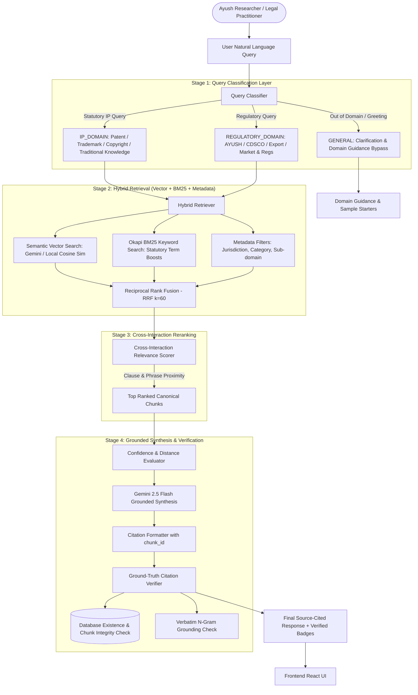

# IP-SAKTI Sahayak (इंटेलेक्चुअल प्रॉपर्टी - शक्ति सहायक)
### **SIH Problem Statement SIH26045 · Ministry of Ayush**
> **A Multilingual, Source-Cited RAG-Based AI Assistant for Ayurveda Intellectual Property & Regulatory Compliance (Across National & International Regimes)**

[](https://fastapi.tiangolo.com)
[](https://reactjs.org)
[](https://www.typescriptlang.org)
[](https://tailwindcss.com)
[](https://github.com/pgvector/pgvector)
[](https://pytest.org)

---

## 🏛️ Executive Summary

Ayurvedic researchers, entrepreneurs, and pharmaceutical manufacturers in India face a complex, fragmented web of statutory compliance. From **Section 3(p) of the Patents Act, 1970** (non-patentability of traditional knowledge) and **National Biodiversity Authority (NBA) Access and Benefit Sharing (ABS)** to **Schedule T Good Manufacturing Practices** and **US FDA Botanical Drug guidance**, navigating these regulations often results in unintentional biopiracy violations or delayed international market access.

**IP-SAKTI Sahayak** is an audit-ready, enterprise-grade regulatory intelligence system engineered to address these challenges with **strict factual grounding and zero hallucination**.

---

## 🌟 Core Technical Architecture & Implemented Components

IP-SAKTI Sahayak implements an end-to-end multi-stage statutory RAG pipeline:



### 1. Query Classification Layer (`app/core/query_classifier.py`)
- Automatically classifies incoming user queries into:
  - **`IP_DOMAIN`**: Patent (§3(p), novelty, inventive step), Trademark (Class 5, logo, AYUSH brand), Copyright (manuscripts, Samhita commentaries), Traditional Knowledge (TKDL, prior art, biopiracy, NBA/ABS).
  - **`REGULATORY_DOMAIN`**: AYUSH (Rule 158-B, Schedule T GMP, SLA licensing), CDSCO (clinical trials, phytopharmaceuticals, DCGI), Export (Ayush Standard/Premium Mark, heavy metals, US FDA Botanical Drug, WHO-GMP), Market/Regulatory requirements (labeling, packaging, shelf life, stability studies).
  - **`GENERAL`**: General queries, greetings, and out-of-domain questions are detected and given a structured **Domain Guidance & Clarification Bypass**, preventing LLM hallucination and protecting API quotas.

### 2. Hybrid Retrieval with Okapi BM25 & RRF (`app/core/hybrid_retriever.py`)
- Combines semantic vector similarity with **Okapi BM25** keyword search.
- Features **Statutory Exact Phrase Boosting** for key legal clauses (e.g. `Section 3(p)`, `Rule 158-B`, `Schedule T`, `TKDL`, `Charaka Samhita`, `Biological Diversity Act`).
- Merges vector and lexical results via **Reciprocal Rank Fusion (RRF)** ($k=60$), eliminating duplicate candidates while prioritizing consensus documents.

### 3. Cross-Interaction Relevance Reranking (`app/core/reranker.py`)
- Evaluates candidate chunks against the user's specific statutory query.
- Scores exact clause matches, query term proximity, n-gram bigrams, and section title alignment.
- Employs a **safe fallback mechanism** that gracefully defaults to hybrid rank order if disabled or unavailable.

### 4. Ground-Truth Citation Verification (`app/core/citation_verifier.py`)
- Multi-point integrity verification on every citation:
  1. **Database Existence Check**: Verifies that referenced document ID exists and is active.
  2. **Chunk Integrity Check**: Validates that citation `chunk_id` corresponds to the exact database record retrieved.
  3. **Metadata Alignment**: Validates jurisdiction, title, and section number against statutory database records.
  4. **Verbatim Grounding Check**: Measures n-gram text overlap between the citation snippet and the source chunk content, rejecting fabricated or tampered excerpts.
- Citations display **`[VERIFIED]`** badges on the user interface with expandable grounding details.

---

## 📂 Repository Structure

```
ip-sakti/
├── backend/
│   ├── app/
│   │   ├── main.py                    # FastAPI entrypoint, lifespan auto-seeding, CORS
│   │   ├── config.py                  # Pydantic Settings & environment variables
│   │   ├── api/
│   │   │   ├── deps.py                # Database session dependency
│   │   │   └── routes/
│   │   │       ├── chat.py            # POST /api/v1/chat — Grounded Q&A endpoint
│   │   │       ├── documents.py       # Corpus upload, deletion, listing, seed API
│   │   │       └── health.py          # GET /health — System metrics & DB status
│   │   ├── core/
│   │   │   ├── query_classifier.py    # Query Classification (IP, Regulatory, General)
│   │   │   ├── hybrid_retriever.py    # Vector + BM25 + Reciprocal Rank Fusion (RRF)
│   │   │   ├── reranker.py            # Cross-interaction statutory clause reranker
│   │   │   ├── citation_verifier.py   # Ground-truth citation verification engine
│   │   │   ├── rag_pipeline.py        # Complete RAG orchestration
│   │   │   ├── embeddings.py          # Dual embedding engine (Gemini / Local vectorizer)
│   │   │   ├── llm_client.py          # Grounded synthesis engine (Gemini / Offline mode)
│   │   │   ├── citation.py            # Source document and section attribution
│   │   │   ├── confidence.py          # Semantic distance scoring & fallback triggers
│   │   │   └── translation.py         # Multilingual translation wrapper
│   │   ├── ingestion/
│   │   │   ├── loaders.py             # PDF, Markdown, and TXT parsing
│   │   │   ├── chunking.py            # Legal-aware hierarchical section chunker
│   │   │   └── ingest_pipeline.py     # Ingestion workflow with SHA-256 deduplication
│   │   ├── models/
│   │   │   ├── db_models.py           # SQLAlchemy tables (Document, DocumentChunk, ChatLog)
│   │   │   └── schemas.py             # Pydantic schemas (Classification, Citation, Chat)
│   │   ├── db/
│   │   │   └── session.py             # Engine & session factory (Postgres/SQLite)
│   │   └── utils/
│   │       └── logger.py              # Structured logging utility
│   ├── data/
│   │   └── seed_corpus/               # 6 curated core Ayush & IP statutory documents
│   ├── tests/
│   │   ├── conftest.py                # In-memory test DB & fixtures
│   │   ├── test_api.py                # End-to-end API route tests
│   │   ├── test_chunking.py           # Regulatory chunker section tests
│   │   ├── test_confidence.py         # Semantic confidence & fallback tests
│   │   ├── test_query_classifier.py   # Classification domain & subdomain unit tests
│   │   ├── test_hybrid_retrieval.py   # BM25 indexing & RRF fusion unit tests
│   │   ├── test_reranker.py           # Cross-interaction reranking unit tests
│   │   └── test_citation_verification.py # Ground-truth citation verification unit tests
│   ├── requirements.txt
│   ├── Dockerfile
│   └── .env.example
├── frontend/
│   ├── src/
│   │   ├── components/
│   │   │   ├── Disclaimer.tsx         # Persistent statutory disclaimer banner
│   │   │   ├── LanguageSelector.tsx   # Indic language switcher (8 languages)
│   │   │   ├── CitationCard.tsx       # Expandable source card with Verified badge
│   │   │   ├── MessageBubble.tsx      # Chat bubbles with Domain pill & Confidence badges
│   │   │   ├── ChatWindow.tsx         # Conversation surface with starter prompts
│   │   │   └── DocumentUpload.tsx     # Drag-and-drop corpus uploader
│   │   ├── pages/
│   │   │   ├── Home.tsx               # Public chat view
│   │   │   └── Admin.tsx              # Regulatory corpus management view
│   │   ├── api/
│   │   │   └── client.ts              # Typed API client with QueryClassification & Citation
│   │   ├── hooks/
│   │   │   └── useChat.ts             # State management for chat
│   │   ├── App.tsx
│   │   └── main.tsx
│   ├── package.json
│   ├── vite.config.ts
│   ├── tailwind.config.js
│   ├── nginx.conf
│   └── Dockerfile
├── docker-compose.yml                 # Full stack (Postgres+pgvector, Backend, Frontend)
├── README.md
└── .gitignore
```

---

## 📜 Curated Seed Knowledge Base

Preloaded in `backend/data/seed_corpus/`:
1. **The Patents Act, 1970 — Section 3(p)**: Statutory prohibition against patenting traditional Ayurvedic knowledge and prior art in classical texts (*Charaka Samhita*, *Sushruta Samhita*).
2. **Biological Diversity Act, 2002**: Mandatory National Biodiversity Authority (NBA) approvals and Access and Benefit Sharing (ABS) mechanisms.
3. **Drugs and Cosmetics Act, 1940 & Rules 1945 — Chapter IV-A**: Special provisions for Ayurvedic, Siddha, and Unani drugs; Rule 158-B licensing; Schedule T Good Manufacturing Practices.
4. **Traditional Knowledge Digital Library (TKDL) Guidelines**: Over 450,000 formulations mapped to IPC; bilateral defensive protection agreements with USPTO, EPO, JPO, UKIPO.
5. **Ministry of Ayush Export Guidelines & WHO-GMP Standards**: Ayush Standard Mark, Ayush Premium Mark, and permissible limits for heavy metals, microbes, and aflatoxins.
6. **US FDA Botanical Drug Guidance for Industry**: Dual pathway (Dietary Supplement under DSHEA 1994 vs Botanical Prescription Drug under CDER).

---

## 🚀 Getting Started

### Option 1: Instant Local Setup (Zero Dependencies)

#### 1. Backend Setup
```bash
cd backend

# Install Python requirements
pip install -r requirements.txt

# Run database seeder (initializes SQLite DB and ingests seed corpus)
python scripts/seed_db.py

# Start FastAPI server
uvicorn app.main:app --reload --port 8000
```
Backend API will be live at: `http://localhost:8000` (Docs: `http://localhost:8000/docs`)

#### 2. Frontend Setup
```bash
cd frontend

# Install dependencies
npm install

# Start Vite development server
npm run dev
```
Frontend UI will be live at: `http://localhost:5173`

---

### Option 2: Production Containerized Setup (Docker Compose)

```bash
# Build and spin up PostgreSQL + pgvector, Backend, and Frontend
docker-compose up --build
```
- Frontend: `http://localhost:3000`
- Backend API: `http://localhost:8000`
- Database: `localhost:5432` (`ip_sakti`)

---

## 🧪 Running Automated Tests

Run the full pytest suite (28 comprehensive unit & integration tests):
```bash
cd backend
python -m pytest tests -v
```

All 28 tests cover:
- **Query Classification**: IP domains (Patent, Trademark, Copyright, Traditional Knowledge), Regulatory domains (AYUSH, CDSCO, Export, Market requirements), and General clarification bypass.
- **Hybrid Retrieval**: BM25 exact scoring, statutory phrase boosting, and Reciprocal Rank Fusion (RRF) candidate deduplication.
- **Cross-Interaction Reranking**: Statutory clause match scoring, proximity boosts, and safe fallback behavior.
- **Citation Verification**: Database record existence, chunk association via `chunk_id`, metadata checks, and tampered snippet rejection.
- **API Endpoints & Ingestion**: `/health`, `/documents`, `/chat`, hierarchical section chunking, and confidence thresholds.

---

## ⚖️ Statutory Disclaimer
*IP-SAKTI Sahayak is an automated research aid developed for SIH 2026. Outputs are grounded in official texts but do not constitute formal legal counsel.*
